# NostalgiaConsole

**One console-style home screen for everything you play and watch.**

NostalgiaConsole brings your Steam games, games from other launchers, retro
games, games streamed from your other PCs, and your movies and TV from
Jellyfin together in one controller-friendly dashboard, styled after the
consoles you grew up with: the 2011 Xbox 360 tiles by default, or seven
other looks. It runs on Linux, Windows and the Steam Deck, and it makes a
TV PC or a Steam Deck feel like a console instead of a desktop.

It is **not an emulator**. NostalgiaConsole doesn't run any game itself; it
reads the libraries you already have and starts each thing with the
program that owns it (Steam, RetroArch, Moonlight, or its own video
player). Think of it as the console's home screen, sitting on top of
everything else.

This is also a work in progress. If this project does well, more console
styles and more features will be added!!!


| | |
| --- | --- |
|  |  |

More in [Screenshots](#screenshots) and [Dashboard styles](#dashboard-styles).

> ❤️ Enjoying NostalgiaConsole? You can [support it on Venmo (@ablatnick)](https://venmo.com/u/ablatnick).

## Everything in one place

| What | Where it comes from | What you get | What you need |
| --- | --- | --- | --- |
| **Steam games** | your Steam folder | installed games, play time, your custom art, downloads in progress, collections, achievements, friends | Steam installed and logged in |
| **Other launchers** | non-Steam games you added to Steam (Epic, GOG, emulators, apps) | an apps pivot, with play time NostalgiaConsole keeps for them | add them to Steam once |
| **Retro games** | your RetroArch playlists | a retro pivot with box art and play time; each game starts in the right core | RetroArch with a scanned playlist ([setup](#retroarch)) |
| **Streamed games** | Moonlight's paired hosts (Sunshine or GeForce Experience) | every app on every PC; a sleeping PC is woken first | Moonlight, paired once ([setup](#moonlight)) |
| **Movies and TV** | your Jellyfin server | continue watching, next up, movies, shows, and a built-in player that syncs your progress | a Jellyfin address and API key ([setup](#connect-steam-and-jellyfin)) |

They all share the same dashboard. **Quick resume** picks up whichever you
used last (a game or the episode you were watching), search finds games
and streams from every source, pins and the guide work everywhere, and a
kid profile can be limited to any mix of games and streams.

How each one starts:

- Steam games and non-Steam games: through Steam (`steam://rungameid/…`),
  so the Steam overlay, controller settings and play time keep working.
- Retro games: RetroArch, with the core and file from its own playlist.
- Streams: `moonlight stream <host> <app>`.
- Movies and TV: NostalgiaConsole's own full-screen player, streaming from
  Jellyfin.

## Quick start

1. Download the latest file for your system from
   [Releases](../../releases): the `.AppImage` for Linux and the Steam
   Deck, or the `Setup .exe` / portable `.exe` for Windows.
2. Make sure Steam is installed and you're logged in, then start
   NostalgiaConsole. It finds your Steam library (and RetroArch, if you have
   it) on its own, and a short setup lets you pick a style, colors, your
   name and avatar.
3. Use a controller (or the keyboard: arrows, Enter, Esc, Q/E to switch
   pivots, G for the guide).
4. Optional: pair your PCs in Moonlight to get a streaming pivot, and
   connect Jellyfin in **settings** for a video pivot.

Steam Deck, Moonlight, RetroArch and Jellyfin setup are under
[Install](#install) and [Connect Steam and Jellyfin](#connect-steam-and-jellyfin).

## Dashboard styles

Pick the whole home screen in **settings > customize > dashboard style**
(or from the guide). Each profile keeps its own. Every style shows the same
games, retro games, streams, videos, friends and settings, and A / X / Y /
menu and the guide work the same in all of them.

| | |
| :---: | :---: |
| <br>**360 metro** (2011), the default | 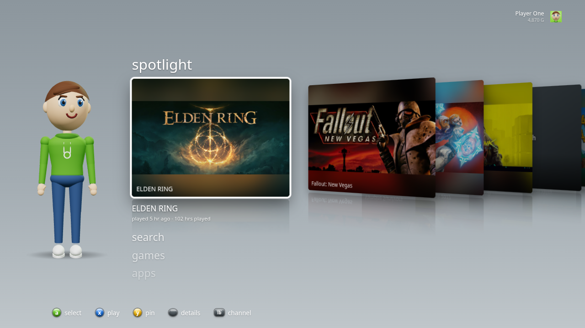<br>**360 nxe** (2008): channels and a 3D card fan, with your avatar |
| 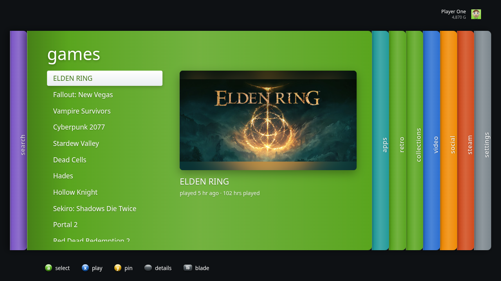<br>**360 blades** (2005): one coloured blade per section | 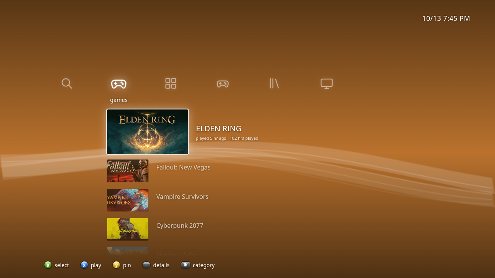<br>**Cross media bar**: categories across, items down, over a monthly wave |
| 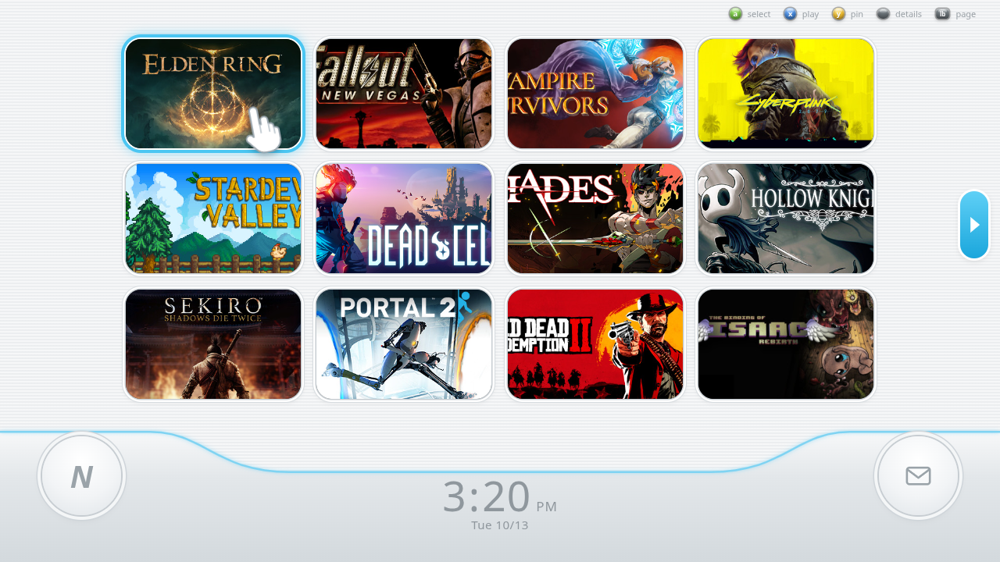<br>**Channels**: pages of rounded channels and a clock bar | 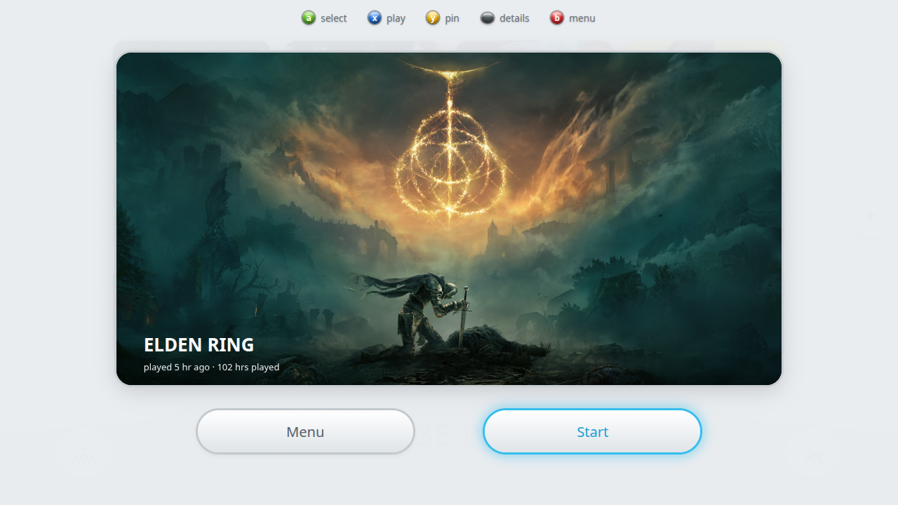<br>Channels: the preview screen before a game starts |
| 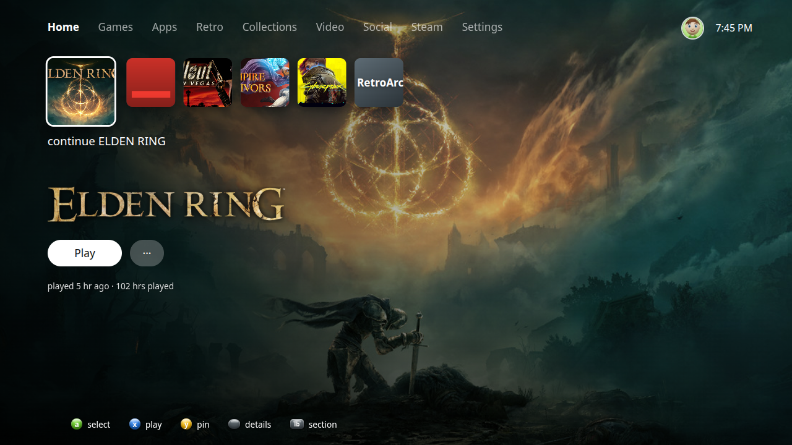<br>**Modern cards**: an icon row over the game's own artwork | 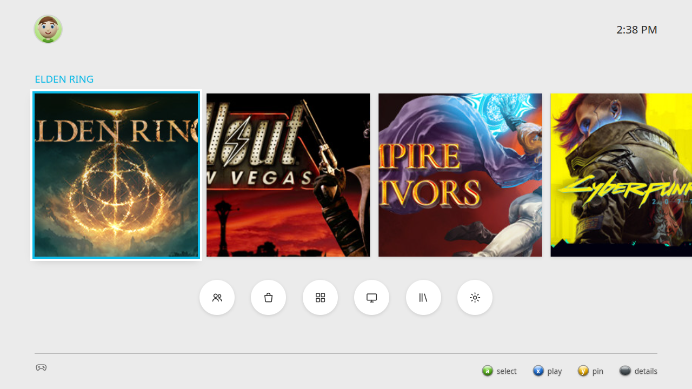<br>**Tile strip**: big square tiles and round shortcuts, light or dark |
| 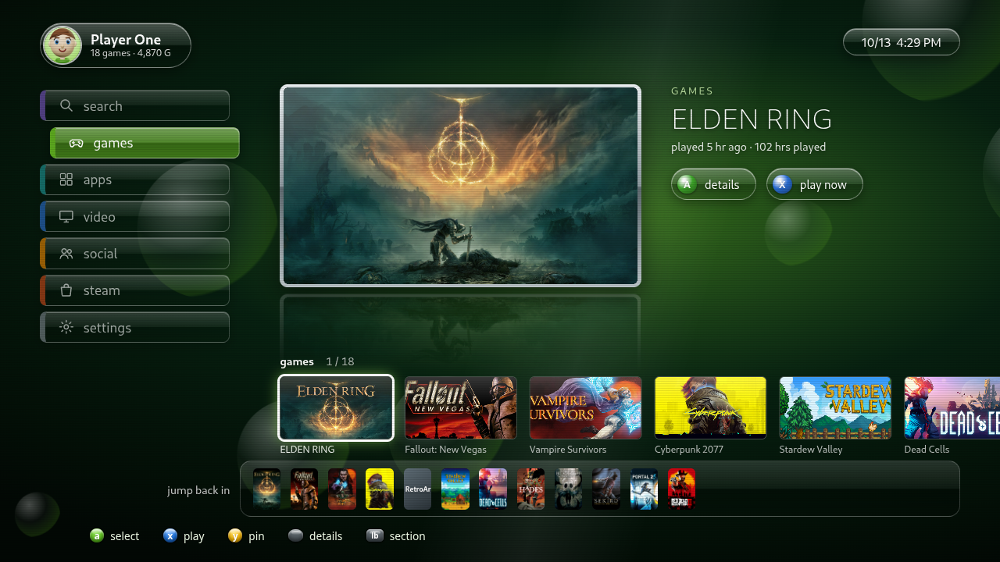<br>**Retro plus**: glossy mid-2000s menus with a framed, mirrored preview | 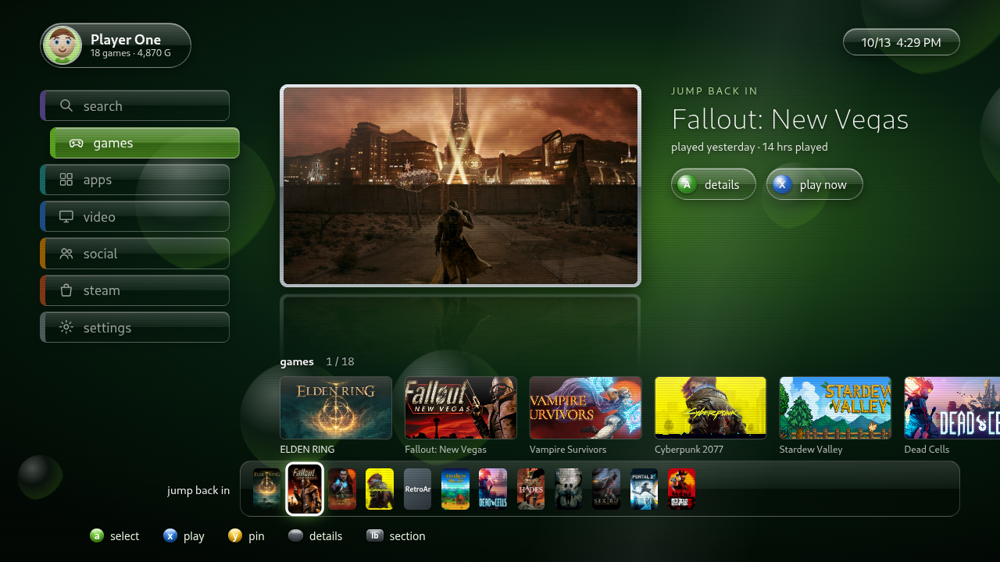<br>Retro plus: a jump back in dock of recent games, always one press away |

The styles are original takes on what those console home screens felt
like; they use no console makers' logos, fonts, sounds or artwork.

## Features

**Your library**

- Steam games, non-Steam games and RetroArch games side by side, with play
  time, your custom grid art and RetroArch box art. A game library sorted
  by recent, A to Z, most played or size, with pins, and **sort and
  filter** for every style from the guide.
- **Steam collections** (Favorites and your own) as folders. Games you hid
  in Steam stay hidden, and you can hide anything else from its details.
- **Downloads** in progress, and games you've played on your account but
  haven't installed here (one press to install), without an API key.
- **Quick resume**: "continue …" for your last game or video.

**Play and watch**

- **Moonlight streaming** from every paired PC, with **Wake-on-LAN** so a
  sleeping PC turns on first, and pairing a new PC from the dashboard.
- **Jellyfin**: continue watching, next up, movies and shows, played in a
  built-in player that saves your place.
- **Power** options in the guide: sleep, restart, shut down, or restart
  Steam when it gets stuck.

**Social and achievements**

- **Gamerscore** (10G per achievement), an **achievements** screen for
  each game, and "achievement unlocked" pop-ups over your game.
- A **social** pivot with your Steam friends and **friend alerts** when
  someone comes online or starts a game. All of this works without an API
  key (see [what a key adds](#connect-steam-and-jellyfin)).

**Make it yours**

- **Eight dashboard styles** (above). The default is the 2011 pivots:
  search, home, games, apps, retro, collections, video, streaming, social,
  steam and settings, with LB/RB to switch. Hide any section in
  settings > customize.
- **Customize** tile and background colors, tile size and text size in
  every style; the panel sits at the side so you see each change live.
- **3D avatars** you build in the avatar editor, with 25 costumes. Each
  profile gets its own avatar, and the "who's playing?" sign-in shows
  everyone's avatar standing side by side.
- Four themes, console-style notifications, synthesized sounds (or your own
  [sound pack](#sound-pack)), **background music** from your own files, a
  boot animation and a **screensaver** that drifts through your game art.

**Family and comfort**

- **Kid profiles** that only see the games a parent allows, with no store,
  settings or quitting; leaving one takes the parent PIN.
- **Controls** screen listing every button, with controller remapping.
- **Reduce motion**, **high contrast**, and a **lite mode** for the Steam
  Deck and slower PCs.
- A first-run **setup**, **one-press updates**, and **start at login**.
- Controller first; keyboard and mouse work too. Gamepad input is ignored
  while a game or stream window has focus.

<details>
<summary>Everything in the avatar editor</summary>

Body type, height, skin, 15 hair styles and colors, eyes, eyebrows, mouth,
facial hair, face markings, 8 kinds of glasses, 12 hats, tops (suits,
flannels, jerseys and more), bottoms, shoes and extras like a scarf,
backpack or watch. Y gives you a random avatar. The 25 costumes are power
armor, bounty hunter, caped hero, ninja, samurai, viking, knight, pirate,
cowboy, chef, firefighter, scientist, astronaut, pilot, trooper, robot,
fox/cat/bear and dino hoodies, zombie, mummy, robe, wizard and alien, each
with a costume color. Gamerpics can be your Steam picture, your avatar's
head, or any picture in the `gamerpics` folder in the user data folder.

</details>

## Controls

| Pad | Keyboard | Action |
| --- | --- | --- |
| D-pad / left stick | Arrows / WASD | Move |
| A | Enter / Space | Select, game details, or stream |
| B | Esc / Backspace / right-click | Back (on the dashboard: go home) |
| X | X | Play now |
| Y | Y | Pin / unpin (otherwise opens the game library) |
| LB / RB | Q / E | Switch pivots (or the style's sections), or change sort in the library |
| LT / RT | Page Up / Page Down | Jump a page in long lists |
| Menu / Start | M | Game details |
| View / Back, Guide | Tab, G / Home | Guide (LB/RB switch tabs) |
| | F11 | Full screen |

Settings > controls lists all of this in the app, and lets you give any
action a different controller button.

## Screenshots

| | |
| --- | --- |
|  |  |
|  |  |
|  |  |
|  |  |
|  |  |
| 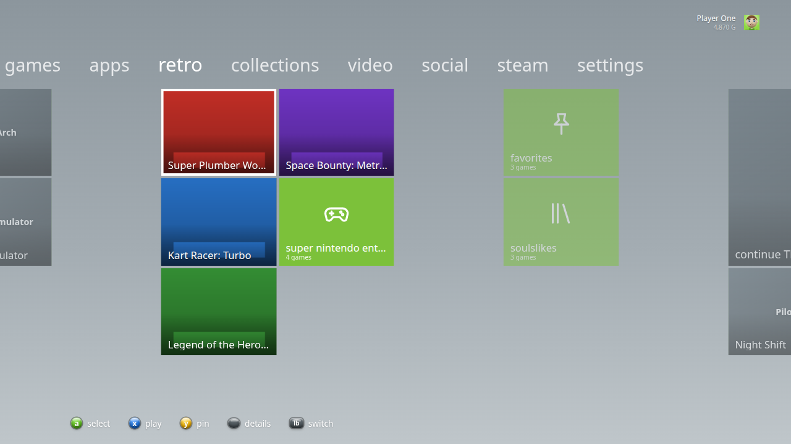 | 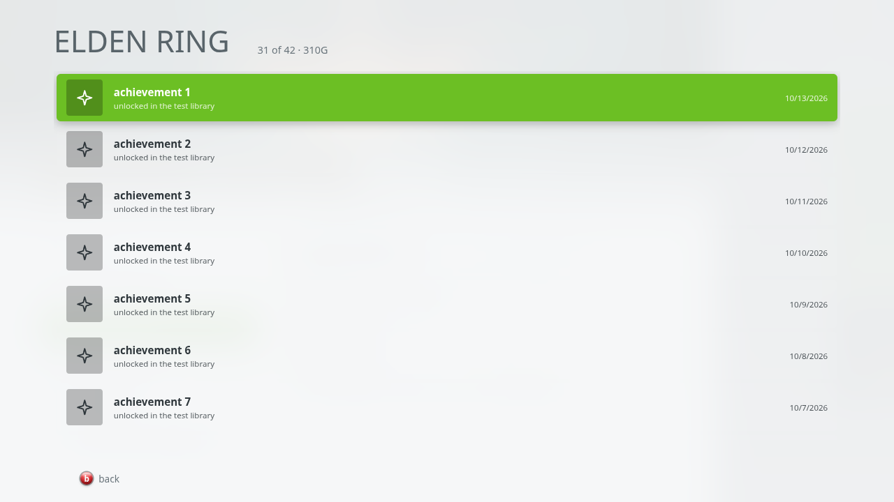 |
| 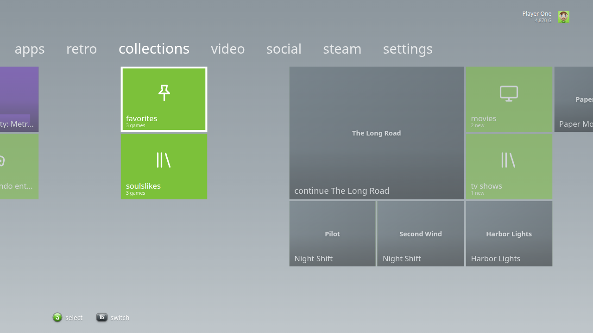 |  |

Screenshots use the test library from `test/make-fixture.js` and
`test/web-fixture.json`; `test/readme-shots.sh` regenerates them all.

## Install

Download the file for your system from [Releases](../../releases)
(Linux, Steam Deck and Windows; there is no macOS build):

- **Linux / Steam Deck**: `NostalgiaConsole-<version>.AppImage`. Make it executable
  and run it.
- **Windows**: `NostalgiaConsole Setup <version>.exe` (installer) or
  `NostalgiaConsole-<version>-portable.exe`.

### Steam Deck / Big Picture

1. In Desktop Mode, put the AppImage somewhere permanent, for example
   `~/Applications/`.
2. In Steam, choose **Games > Add a Non-Steam Game** and pick the AppImage.
3. Back in Game Mode, start NostalgiaConsole from your library. Games you launch
   from it open on top of it, and you return to it when they exit.

Set **after launch** to `close` in settings if you'd rather NostalgiaConsole quit
when a game starts.

### Moonlight

Install Moonlight (moonlight-qt) and pair your hosts in it once. NostalgiaConsole
reads the paired hosts from Moonlight's settings and asks each host for its
apps (`moonlight list`). Selecting a tile runs
`moonlight stream <host> <app>`. To stream single games instead of the
whole desktop, add them as apps in Sunshine. A neat trick: add NostalgiaConsole
itself as a Sunshine app on your gaming PC, so streaming it from a TV gives
you the whole dashboard.

On a Windows Sunshine host, `scripts/add-to-sunshine.ps1` installs
NostalgiaConsole and adds it as a Sunshine app with its own game-case style cover
(`build/boxart/nostalgiaconsole-boxart.png`, made by `node build/boxart/make-boxart.mjs`),
so it shows up in Moonlight next to Desktop and Steam Big Picture:

```powershell
.\add-to-sunshine.ps1 -Source <folder or http URL holding the installer and cover>
```

Moonlight is found as `moonlight-qt`/`moonlight` on `PATH`, the snap, the
Flatpak (`com.moonlight_stream.Moonlight`), or the default install folder on
Windows. Set `MOONLIGHT_BIN` to override. (There is no macOS build yet.)

**Pair a new PC** from the streaming pivot: type the PC's name or address,
and NostalgiaConsole shows a PIN to enter in Sunshine's web page
(`https://localhost:47990` on that PC, under PIN).

**Wake-on-LAN.** With **wake before streaming** on (the default), picking a
stream on a PC that's asleep sends it a Wake-on-LAN packet and waits (up to
about a minute and a half) for it to come up, then starts the stream. It
needs the PC's network (MAC) address: Moonlight remembers it when it has
connected on your home network; otherwise enter it once under
**streaming > wake on lan** (on Windows, `getmac /v` shows it). The PC needs
Wake-on-LAN turned on in its BIOS and network adapter settings, and the
packet only reaches PCs on the same home network (not over a VPN such as
Tailscale).

### RetroArch

Install RetroArch, add your cores, and scan your games into playlists
(**Import Content** in RetroArch). NostalgiaConsole reads those playlists
and shows them in a **retro** pivot, one folder per system, with the box art
RetroArch downloaded (**Online Updater > Playlist Thumbnails Updater**).
Turn on **Settings > Saving > Save Runtime Log (Per Core)** in RetroArch to
get its play time; otherwise NostalgiaConsole times the sessions itself.

It looks for RetroArch in the usual places: `~/.config/retroarch`, the
Flatpak (`org.libretro.RetroArch`), the snap, Steam's RetroArch, and on
Windows `%APPDATA%\RetroArch`, `C:\RetroArch-Win64` or `C:\RetroArch`. Set
`RETROARCH_DIR` to the folder with `retroarch.cfg` to use another one.
Games start with the core and file saved in the playlist; nothing else
can be passed to RetroArch.

## Connect Steam and Jellyfin

Both are optional and set up in **settings** with the on-screen keyboard (a
physical keyboard and paste work too). Keys are stored in `secrets.json` in
the user data folder, readable only by you, and never shown in the UI.

- **steam web api** (optional). Without a key, everything comes from
  Steam's files on this PC and from public Steam profiles:
  - achievements and gamerscore for games whose stats Steam has saved on
    this PC (games you've played here);
  - friends that the Steam client has cached on this PC;
  - online status and current game for friends with public profiles
    (friends with private profiles show as offline).

  A key from <https://steamcommunity.com/dev/apikey> adds games you own but
  haven't installed, the full friends list with status from the Web API,
  and achievements from games played on other PCs. The Web API only
  returns what your Steam privacy settings make public, so set your game
  details and friends list to public if those stay empty.
- **jellyfin**: enter the server address (for example
  `http://192.168.1.10:8096`) and an API key from Jellyfin's
  **Dashboard > API Keys**. Video, images and progress go through
  NostalgiaConsole, which adds the key itself.

On streaming hosts, NostalgiaConsole asks Sunshine for its app list and
covers directly, using this device's Moonlight pairing certificate (and
checking the host's pinned certificate), so it doesn't depend on Moonlight's
cache.

## Sound pack

The interface sounds are synthesized. To use your own, put audio files in
the `sounds` folder in NostalgiaConsole's user data folder
(`~/.config/NostalgiaConsole/sounds` on Linux,
`%APPDATA%\NostalgiaConsole\sounds` on Windows), named after the sound
they replace: `move`, `channel` (switching pivots), `select`, `back`,
`open`, `close`, `notify`, `launch`, `error` and `intro`. Any of `.wav`,
`.ogg`, `.mp3`, `.m4a` or `.flac` works. **Settings > sound pack** opens the
folder and reloads it. Sounds you don't provide keep the built-in version.

## Family

**Settings > family** (behind the parent PIN once one is set):

1. Set a parent PIN (4 to 8 digits).
2. Sign in to the kid's profile, open **family**, and turn on **kid
   profile**.
3. Pick the **allowed games**: any Steam, non-Steam or retro game, and any
   Moonlight stream.

A kid profile sees only those games, with no store, Steam pivot, settings,
power options or quitting. Switching to a grown-up's profile asks for the
PIN.

## Music

Put audio files (`.mp3`, `.ogg`, `.m4a`, `.flac`, `.wav`, `.opus`) in the
`music` folder in the user data folder (**settings > music folder** opens
it), then turn on **settings > background music**. It plays them shuffled,
quietly, and fades out when a game, stream or video starts or another
window comes to the front.

## Start at login and updates

**Settings > start at login** opens NostalgiaConsole when you log in (on a
streaming PC that makes it the first thing you see). On a Steam Deck, add it
as a non-Steam game and launch it from Game Mode.

**Settings > check for updates** looks at the latest release on GitHub.
The Windows installer, the portable `.exe` and the AppImage can download
the new version, check it against the SHA-256 GitHub publishes for it, and
restart into it in one press; other installs link to the release page.
Releases are built by GitHub Actions when a version tag is pushed
(`git tag v1.2.3 && git push --tags`).

## What it connects to

Everything on this list is something you set up, or public Steam data:

- **Steam's files** on this PC (library, play time, friends, achievements,
  collections), and Steam itself to start games.
- **Steam's public servers**: game artwork, achievement icons, store names
  for games you've played but haven't installed, and your friends' public
  profiles for their online status. With an API key, the Steam Web API.
- **Your Moonlight hosts** (Sunshine) for their app lists and covers,
  using Moonlight's pairing certificate.
- **Your Jellyfin server**, with the key you entered.
- **GitHub**, only when you check for updates.

It sends no analytics anywhere.

## Options

- `--steam-root=<folder>` or `STEAM_ROOT`: use this Steam folder. By default
  NostalgiaConsole looks in the usual native, Flatpak, snap and Windows locations.
- `RETROARCH_DIR`: the RetroArch folder (the one with `retroarch.cfg`).
- `--windowed`: start in a window.
- Settings are saved in `settings.json` in the app's user data folder
  (`~/.config/NostalgiaConsole` on Linux, `%APPDATA%\NostalgiaConsole` on Windows).

## Develop

```sh
npm install
npm start                 # windowed, using your real Steam library
npm test                  # parsers, library scan, Moonlight, settings
test/shot.sh out.png "Down,Return" 1280x800 midnight  # offscreen screenshot
test/readme-shots.sh      # every screen, into docs/screenshots (CI runs it too)
npm run dist:linux        # AppImage + tar.gz
npm run dist:win          # needs Wine, or use the electronuserland/builder:wine image
```

`test/make-fixture.js` builds a fake Steam folder (two libraries, play
stats, shortcuts, collections) and a RetroArch folder (a playlist, box art
and a runtime log) that the tests and screenshot scripts use.

On Linux the AppImage starts Electron with `--no-sandbox`. Ubuntu 24.04+
blocks the Chromium sandbox for AppImages. The UI only loads its own bundled
files through a locked-down custom protocol, with a strict CSP.

## Support

If NostalgiaConsole is useful to you, you can support it and other projects on [Venmo (@ablatnick)](https://venmo.com/u/ablatnick).

## License

[MIT](LICENSE). Bundled three.js and hls.js keep their own licenses
(`src/renderer/vendor/*-LICENSE.txt`), and the Nunito font used by the
channels style is under the SIL Open Font License
(`src/renderer/fonts/nunito-OFL.txt`).

NostalgiaConsole is a fan project. It isn't affiliated with Microsoft, Xbox,
Sony, Nintendo, Valve, the Moonlight project, libretro/RetroArch or
Jellyfin, and it ships no assets from them. It doesn't include or download
any games or ROMs; it only shows what you already have.
