# NostalgiaConsole

A full screen dashboard in the style of the 2011 Xbox 360 dashboard for
your Steam library. It runs on Linux, Windows and the Steam Deck, and it
also lists games you can stream from other PCs with Moonlight. Originally designed 
to turn Moonlight into a more console feeling experience without relying on Steam 
big picture.


## Screenshots

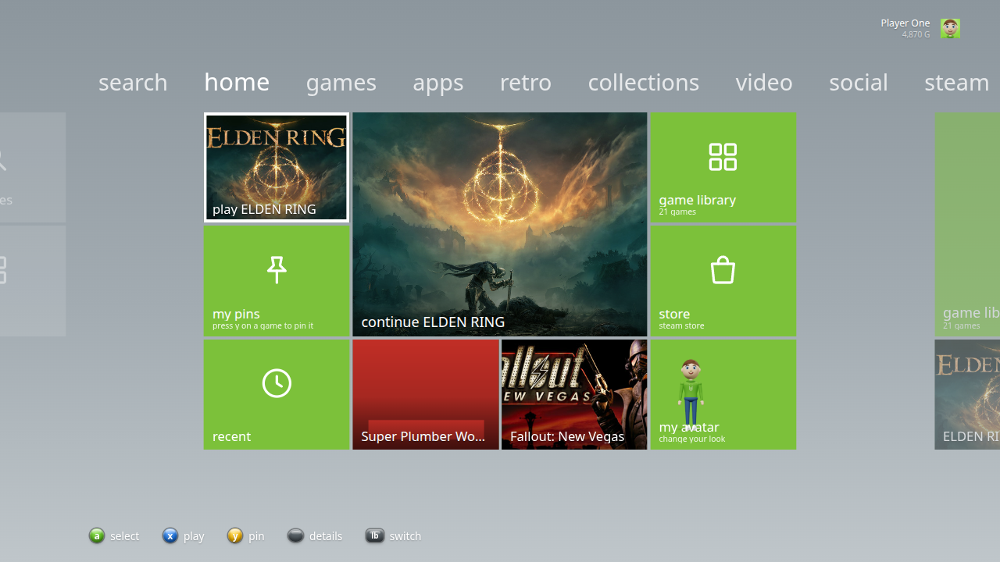

| | |
| --- | --- |
| 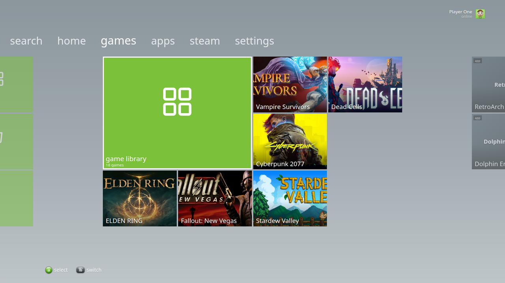 | 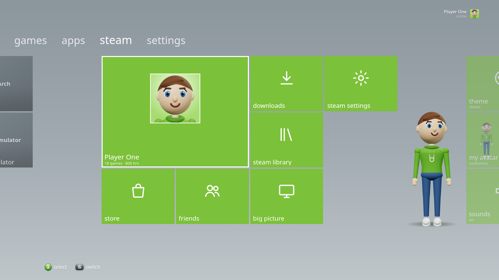 |
| 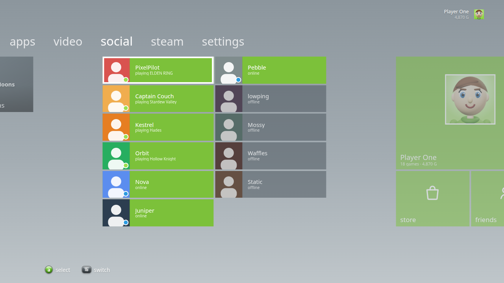 | 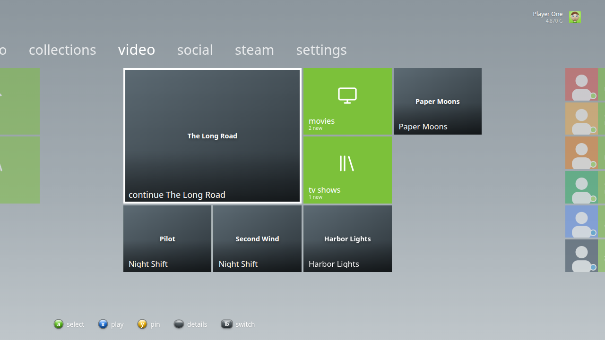 |
| 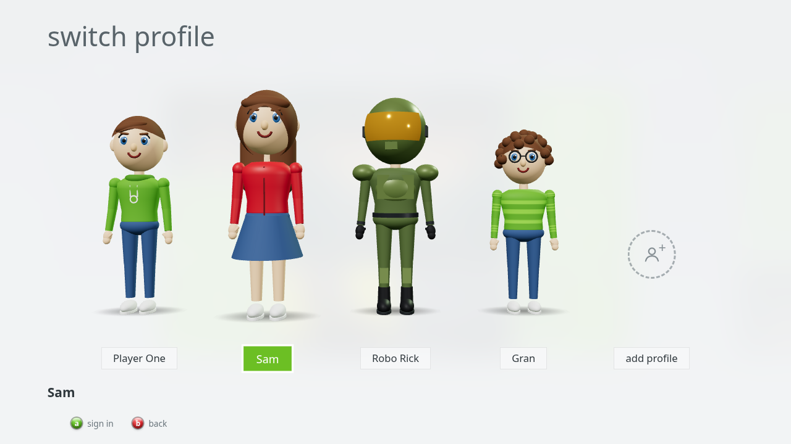 | 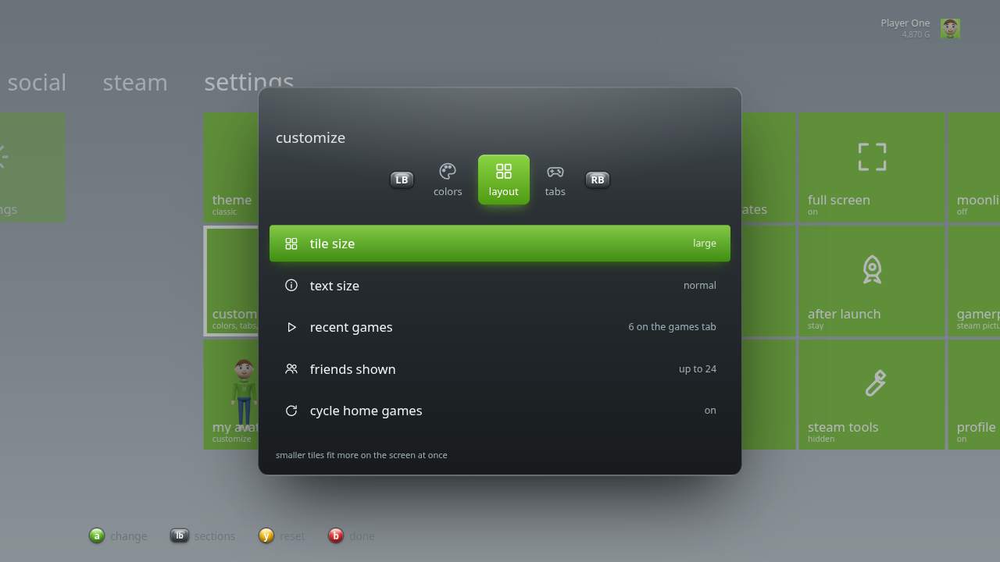 |
| 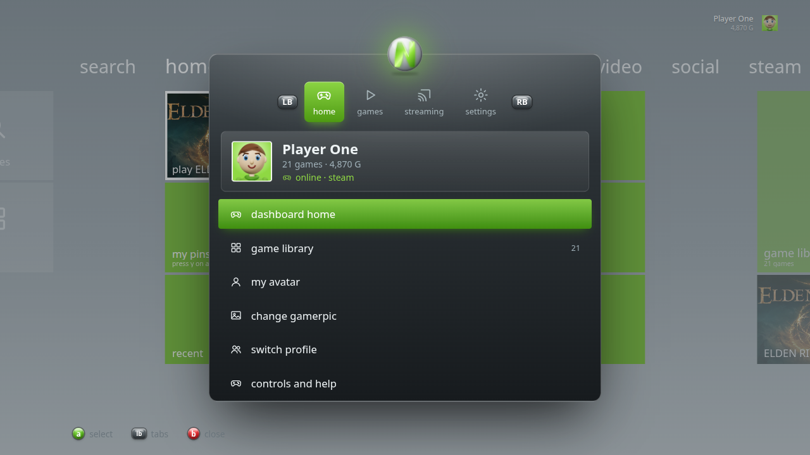 | 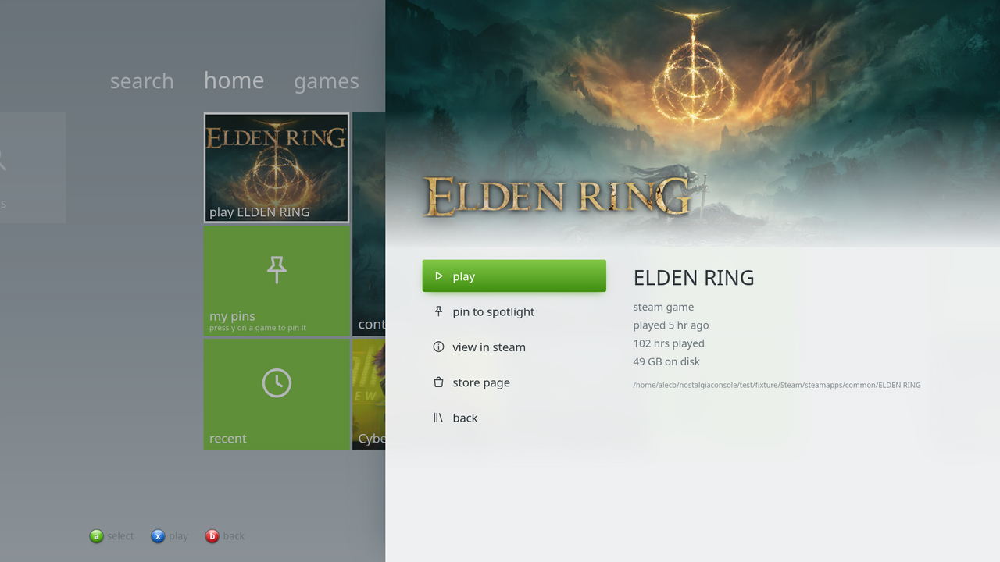 |
| 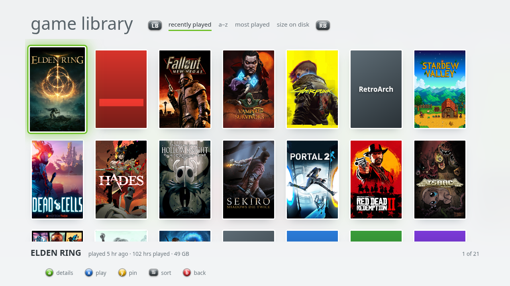 | 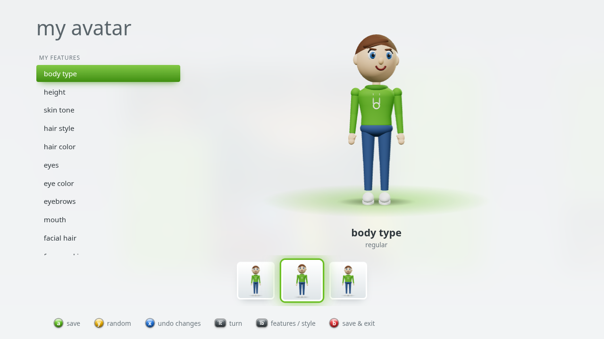 |
| 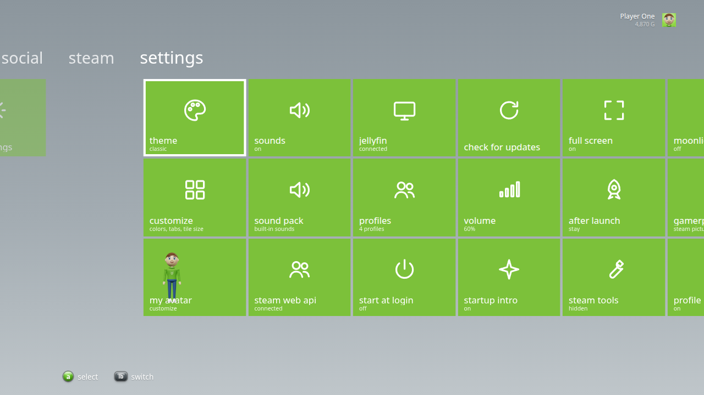 | 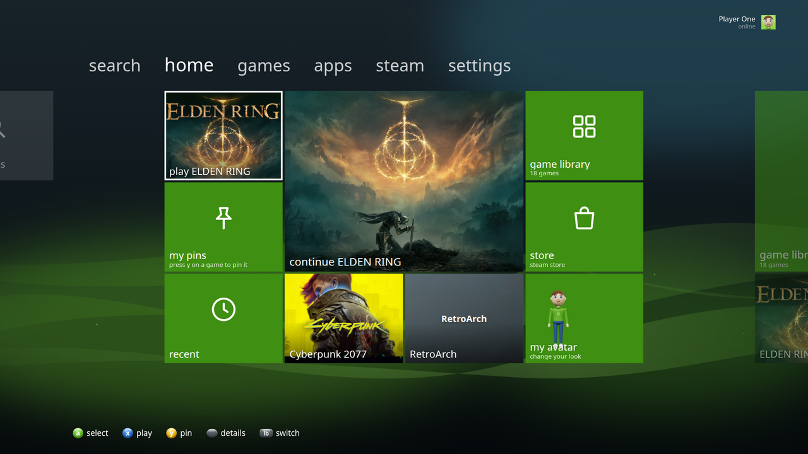 |
| 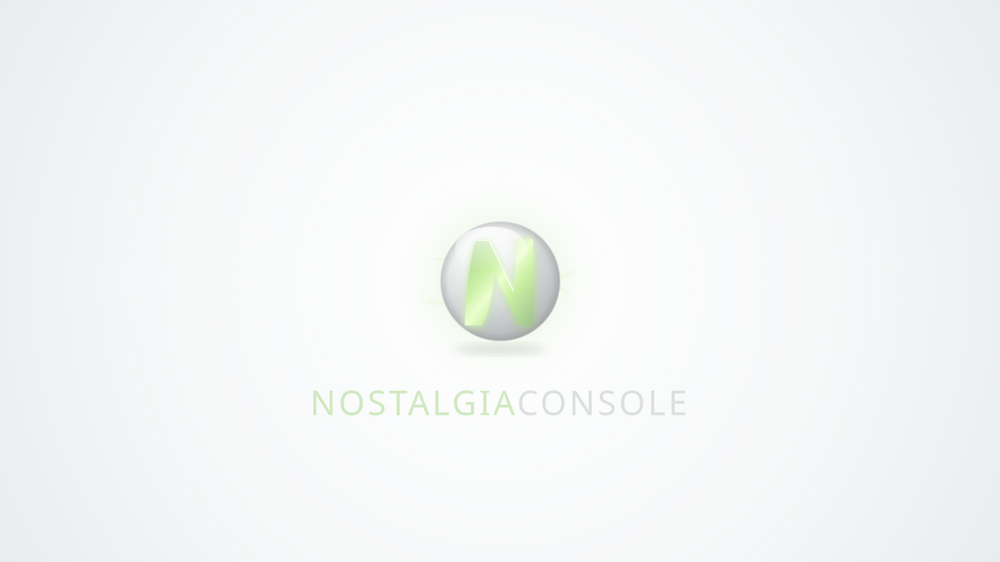 | |

Screenshots use the test library from `test/make-fixture.js` and
`test/web-fixture.json`; `test/readme-shots.sh` regenerates them all.

## Features

- **Pivots** across the top: search, home, games, apps, video, streaming,
  social, steam and settings, each a grid of tiles three tall. LB/RB switch pivots, and
  moving off a grid's edge slides into the next one. Home has your last
  game, pins, recent games, a big "continue" tile and two tiles that cycle
  through your library.
- Reads installed Steam games, non-Steam shortcuts, play time and your own
  custom grid art straight from the Steam folder. Missing art comes from
  Steam's CDN.
- **Game library** grid sorted by recently played, A to Z, most played, or
  size on disk. You can **pin** games to My Pins on home.
- A 3D **avatar** that stands beside the steam pivot. Build it in the
  **my avatar** editor: body type, skin, hair, eyes, eyebrows, mouth, facial
  hair, glasses, hats and clothes, with a live preview. Y gives you a random
  avatar. Pick your height, 15 hair styles, face markings, 8 kinds of
  glasses, 12 hats, suits, flannels, overalls and more, plus extras like a
  scarf, backpack or watch. There are 25 costumes too: power armor, bounty
  hunter, caped hero, ninja, samurai, viking, knight, pirate, cowboy, chef,
  firefighter, scientist, astronaut, pilot, trooper, robot, fox/cat/bear and
  dino hoodies, zombie, mummy, robe, wizard and alien, each with a costume
  color.
- **Gamerscore and achievements**, read from Steam's own files (no key
  needed): a G total on your gamercard, achievements per game, and
  "achievement unlocked" pop-ups that show over your game.
- **Social**: a compact friends list of your Steam friends (picture, name
  and what they're playing), in-game and online friends first, with online
  status from their public profiles.
- **Video**: your Jellyfin server's continue watching, next up, movies and
  shows, with a built-in player that syncs your progress, and "open in
  jellyfin" for Watch Party.
- **Search** with a console-style on-screen keyboard, owned games that
  aren't installed (with install), and download progress and "download
  complete" pop-ups.
- **Profiles** with a "who's playing?" sign-in where everyone's 3D avatar
  stands side by side and idles (stretching, checking a watch, waving). Each
  profile has its own avatar, gamerpic, pins, theme and colors.
- **Customize** (settings > customize): tile color, background color,
  tile size (huge to tiny, so more fits on screen), text size, which tabs
  show (hide video, streaming, social and the rest), how many recent games
  and friends to show, and whether the home tiles cycle. Changes show
  straight away; Y resets them.
- **Gamerpics**: your Steam picture, your avatar's head, or any picture you
  put in the `gamerpics` folder in the user data folder.
- A **guide** with a gamercard and tabs (home, games, streaming, settings),
  console-style pop-up notifications, synthesized interface sounds, a boot
  animation, and four themes: classic, midnight, ember and arctic.
- **Moonlight**: every app on every paired host (Sunshine or GeForce
  Experience) shows up on the streaming pivot and starts with one press.
- Controller first, but keyboard and mouse work too. Gamepad input is ignored
  while a game or stream window has focus.

Games start through Steam (`steam://rungameid/...`), so Steam has to be
installed and logged in. NostalgiaConsole never opens any other URL.

## Controls

| Pad | Keyboard | Action |
| --- | --- | --- |
| D-pad / left stick | Arrows / WASD | Move |
| A | Enter / Space | Select, game details, or stream |
| B | Esc / Backspace / right-click | Back (on the dashboard: go home) |
| X | X | Play now |
| Y | Y | Pin / unpin (otherwise opens the game library) |
| LB / RB | Q / E | Switch pivots, or change sort in the library |
| Menu / Start | M | Game details |
| View / Back, Guide | Tab, G / Home | Guide (LB/RB switch tabs) |
| | F11 | Full screen |

## Install

Download the file for your system from `dist/` (or a release):

- **Linux / Steam Deck**: `NostalgiaConsole-<version>.AppImage`. Make it executable
  and run it.
- **Windows**: `NostalgiaConsole Setup <version>.exe` (installer) or
  `NostalgiaConsole-<version>-portable.exe`.

### Steam Deck / Big Picture

1. In Desktop Mode, put the AppImage somewhere permanent, for example
   `~/Applications/`.
2. In Steam, choose **Games > Add a Non-Steam Game** and pick the AppImage.
3. Back in Game Mode, start NostalgiaConsole from your library. Games you launch
   from it open on top of it, and you return to it when they exit.

Set **after launch** to `close` in settings if you'd rather NostalgiaConsole quit
when a game starts.

### Moonlight

Install Moonlight (moonlight-qt) and pair your hosts in it once. NostalgiaConsole
reads the paired hosts from Moonlight's settings and asks each host for its
apps (`moonlight list`). Selecting a tile runs
`moonlight stream <host> <app>`. To stream single games instead of the
whole desktop, add them as apps in Sunshine. A neat trick: add NostalgiaConsole
itself as a Sunshine app on your gaming PC, so streaming it from a TV gives
you the whole dashboard.

On a Windows Sunshine host, `scripts/add-to-sunshine.ps1` installs
NostalgiaConsole and adds it as a Sunshine app with its own game-case style cover
(`build/boxart/nostalgiaconsole-boxart.png`, made by `node build/boxart/make-boxart.mjs`),
so it shows up in Moonlight next to Desktop and Steam Big Picture:

```powershell
.\add-to-sunshine.ps1 -Source <folder or http URL holding the installer and cover>
```

Moonlight is found as `moonlight-qt`/`moonlight` on `PATH`, the snap, the
Flatpak (`com.moonlight_stream.Moonlight`), or the default install folder on
Windows and macOS. Set `MOONLIGHT_BIN` to override.

## Connect Steam and Jellyfin

Both are optional and set up in **settings** with the on-screen keyboard (a
physical keyboard and paste work too). Keys are stored in `secrets.json` in
the user data folder, readable only by you, and never shown in the UI.

- **steam web api** (optional): gamerscore, achievements and friends work
  without it, from Steam's local files. A key from
  <https://steamcommunity.com/dev/apikey> adds games you own but haven't
  installed, live status for friends with private profiles, and
  achievements from games played on other PCs.
- **jellyfin**: enter the server address (for example
  `http://192.168.1.10:8096`) and an API key from Jellyfin's
  **Dashboard > API Keys**. Video, images and progress go through
  NostalgiaConsole, which adds the key itself.

On streaming hosts, NostalgiaConsole asks Sunshine for its app list and
covers directly, using this device's Moonlight pairing certificate (and
checking the host's pinned certificate), so it doesn't depend on Moonlight's
cache.

## Sound pack

The interface sounds are synthesized. To use your own, put audio files in
the `sounds` folder in NostalgiaConsole's user data folder
(`~/.config/NostalgiaConsole/sounds` on Linux,
`%APPDATA%\NostalgiaConsole\sounds` on Windows), named after the sound
they replace: `move`, `channel` (switching pivots), `select`, `back`,
`open`, `close`, `notify`, `launch`, `error` and `intro`. Any of `.wav`,
`.ogg`, `.mp3`, `.m4a` or `.flac` works. **Settings > sound pack** opens the
folder and reloads it. Sounds you don't provide keep the built-in version.

## Start at login and updates

**Settings > start at login** opens NostalgiaConsole when you log in (on a
streaming PC that makes it the first thing you see). On a Steam Deck, add it
as a non-Steam game and launch it from Game Mode.

Releases are built by GitHub Actions when a version tag is pushed
(`git tag v1.2.3 && git push --tags`); **settings > check for updates**
looks at the latest release.

## Options

- `--steam-root=<folder>` or `STEAM_ROOT`: use this Steam folder. By default
  NostalgiaConsole looks in the usual native, Flatpak, snap and Windows locations.
- `--windowed`: start in a window.
- Settings are saved in `settings.json` in the app's user data folder
  (`~/.config/NostalgiaConsole` on Linux, `%APPDATA%\NostalgiaConsole` on Windows).

## Develop

```sh
npm install
npm start                 # windowed, using your real Steam library
npm test                  # parsers, library scan, Moonlight, settings
test/shot.sh out.png "Down,Return" 1280x800 midnight  # offscreen screenshot
test/readme-shots.sh      # every screen, into docs/screenshots (CI runs it too)
npm run dist:linux        # AppImage + tar.gz
npm run dist:win          # needs Wine, or use the electronuserland/builder:wine image
```

`test/make-fixture.js` builds a fake Steam folder (two libraries, play
stats, shortcuts) that the tests and `test/shot.sh` use.

On Linux the AppImage starts Electron with `--no-sandbox`. Ubuntu 24.04+
blocks the Chromium sandbox for AppImages. The UI only loads its own bundled
files through a locked-down custom protocol, with a strict CSP.

## Support

If NostalgiaConsole is useful to you, you can support it and other projects on [Venmo (@ablatnick)](https://venmo.com/u/ablatnick).

NostalgiaConsole is a fan project. It isn't affiliated with Microsoft, Xbox,
Valve or the Moonlight project, and it ships no assets from them.
